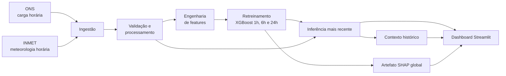

# Previsão de carga elétrica do subsistema Nordeste

Projeto de ciência de dados para ingestão, análise, modelagem, previsão e
explicação da carga elétrica horária do subsistema Nordeste. A solução combina
a carga disponibilizada pelo Operador Nacional do Sistema Elétrico (ONS) com
dados meteorológicos das estações automáticas do Instituto Nacional de
Meteorologia (INMET).

O projeto possui três horizontes independentes de previsão, **1 h, 6 h e 24 h**,
todos modelados com XGBoost. O pipeline baixa os dados, atualiza a base,
reconstrói as variáveis, retreina os modelos com os hiperparâmetros já
selecionados e gera o snapshot mais recente de previsões. Uma aplicação
Streamlit apresenta os resultados, o contexto histórico, a explicabilidade
SHAP e as métricas do experimento.

> Estado documentado em **15/10/2026**. Os números da seção "Estado atual dos
> artefatos" foram conferidos diretamente nos arquivos presentes no
> repositório nessa data. Os outputs preservados nos notebooks representam uma
> fotografia experimental anterior e são identificados separadamente.

## Visão geral do fluxo



O pipeline completo é implementado em `src/pipeline.py` e executa, nesta
ordem:

1. ingestão ONS e INMET;
2. validação, alinhamento horário e consolidação das fontes;
3. engenharia das variáveis de modelagem;
4. retreinamento dos três modelos;
5. inferência na observação mais recente e cálculo do contexto histórico.

Cada etapa roda como um subprocesso e interrompe o fluxo imediatamente se
retornar um código de erro. Os modelos só começam a ser substituídos depois que
os três novos ajustes terminam, reduzindo o risco de um conjunto parcialmente
atualizado.

## Estado atual dos artefatos

| Artefato | Linhas | Colunas | Período | Observação |
|---|---:|---:|---|---|
| `data/interim/load_clean.parquet` | 41.928 | 5 | 01/01/2022 00h a 13/10/2026 23h | Carga ONS do Nordeste, sem nulos ou chaves duplicadas. |
| `data/interim/weather_clean.parquet` | 41.616 | 20 | 01/01/2022 00h a 30/09/2026 23h | Meteorologia regional; havia 3 ausências de radiação antes do processamento. |
| `data/interim/weather_stations_clean.parquet` | 5.871.912 | 27 | 01/01/2022 00h a 30/09/2026 23h | 149 estações, sem duplicidade por estação e timestamp. |
| `data/processed/base.parquet` | 41.616 | 22 | 01/01/2022 00h a 30/09/2026 23h | Base horária consolidada, sem nulos. |
| `data/processed/base_final.parquet` | 41.424 | 51 | 08/01/2022 00h a 29/09/2026 23h | Base rotulada de treinamento, sem nulos. |
| `data/predictions/latest_forecasts.parquet` | 3 | 18 | Origem em 30/09/2026 23h | Uma previsão para cada horizonte. |

A ONS está 312 horas à frente do INMET no estado atual. Como o processamento
faz uma junção interna por timestamp, a base consolidada termina na fonte mais
atrasada: **30/09/2026 23h**. Consequentemente, executar apenas a inferência não
produz uma previsão a partir de 15/10/2026; produz previsões a partir da última
hora comum às duas fontes.

## Fontes e ingestão

### ONS

`src/ingestion/ingest_ons.py` consulta o catálogo CKAN da curva de carga,
seleciona os recursos anuais, baixa os CSVs e mantém somente o subsistema `NE`.
Antes de salvar, a etapa exige:

- timestamps válidos e únicos por subsistema;
- carga numérica, não ausente e não negativa;
- pelo menos um registro válido para o Nordeste.

Os arquivos brutos são guardados em snapshots com timestamp e a saída limpa é
`data/interim/load_clean.parquet`. Atualmente, os anos estão fixados no código
como 2022 a 2026 (`range(2022, 2027)`); a ingestão precisará ser ampliada antes
do primeiro processamento de dados de 2027.

### INMET

`src/ingestion/ingest_inmet.py` cobre dinamicamente 2022 até o ano corrente. Os
ZIPs de anos encerrados são reutilizados da cópia local mais recente, enquanto o
arquivo do ano corrente é baixado novamente. O download usa tentativas,
arquivo temporário e um manifesto com hash SHA-256.

A leitura aceita as variações conhecidas de codificação e cabeçalhos dos CSVs,
normaliza nomes e tipos e limita a base aos nove estados do Nordeste. Quando um
ZIP acumulado contém mais de um CSV para a mesma estação, apenas o membro com a
data final de cobertura mais recente é usado; os demais são registrados como
substituídos. Esse critério impede duplicidades por `station_code + timestamp`.

Valores meteorológicos fora das faixas de validação são convertidos em nulos. A
base regional é então calculada pela média das estações disponíveis em cada
hora; direção do vento usa média circular. `station_count` registra a cobertura
horária. No artefato atual, de 135 a 144 estações contribuem em cada hora, com
média de 141,1.

Para limitar uma execução a estações específicas:

```bash
INMET_STATION_CODES=A301,A305 python -m src.ingestion.ingest_inmet
```

Sem essa variável, todas as estações automáticas do Nordeste são processadas.

## Processamento e qualidade da base

`src/processing/processing.py` valida unicidade temporal nas duas fontes,
converte os timestamps meteorológicos para UTC e remove a informação de fuso
antes do `merge`. Os timestamps da ONS já chegam sem timezone. Portanto, o
alinhamento atual pressupõe que a hora ingênua da ONS e a hora UTC do INMET
representam a mesma referência horária. Essa hipótese ainda precisa ser
confirmada na documentação oficial da fonte; o código não aplica deslocamento
para `America/Recife` ou `America/Sao_Paulo`.

O processamento:

- interpola linearmente apenas `global_radiation_kj_m2`;
- combina ONS e INMET por `timestamp`, com `inner join` e cardinalidade um para
  um;
- remove as colunas textuais redundantes de região/subsistema;
- rejeita timestamps duplicados ou qualquer nulo residual;
- grava `data/processed/base.parquet` de forma atômica.

Cada linha da base final representa uma hora e contém a carga do Nordeste, o
ano de origem e as seguintes famílias meteorológicas: precipitação, pressão,
radiação, temperatura, ponto de orvalho, umidade, velocidade/rajada/direção do
vento e quantidade de estações.

## Análise exploratória

O notebook `notebooks/03_eda.ipynb` investiga distribuição, tendência,
sazonalidade horária/semanal/mensal, decomposição anual, relação com
temperatura, correlações, autocorrelação, rampas e picos. Recalculando as
estatísticas descritivas sobre o `base.parquet` atual:

| Medida | Resultado |
|---|---:|
| Média | 12.589,73 MWmed |
| Mediana | 12.628,52 MWmed |
| Desvio-padrão | 1.525,69 MWmed |
| Mínimo | 7.262,28 MWmed |
| P01 / P99 | 8.862,52 / 15.630,71 MWmed |
| Máximo | 18.156,97 MWmed |

Principais padrões observados:

- a média anual subiu de 11.171,08 MWmed em 2022 para 13.266,86 MWmed em
  2025; 2026 tem média parcial de 13.500,14 MWmed até setembro;
- o vale horário médio ocorre às 06h (11.337,48 MWmed) e o pico às 21h
  (13.841,32 MWmed);
- domingo possui a menor média semanal (11.492,81 MWmed); quarta-feira, a maior
  no recorte atual (12.944,31 MWmed), muito próxima de quinta-feira;
- julho tem a menor média mensal (11.947,04 MWmed) e novembro, a maior
  (13.154,86 MWmed);
- a correlação linear entre temperatura e carga é moderada e positiva
  (`r = 0,4475`), sem implicação causal;
- a autocorrelação é 0,9700 em 1 h, 0,8212 em 24 h e 0,9085 em 168 h,
  justificando lags diários e semanais;
- as rampas horárias têm P01 de -709,29 MWmed e P99 de +1.086,88 MWmed, com
  extremos de -3.255,47 e +3.595,71 MWmed.

Os percentis descrevem a posição de uma carga dentro do histórico e **não são
limites técnicos ou classificações operativas do Sistema Interligado Nacional**.
O arquivo `reports/eda_summary.md` e os outputs do notebook ainda refletem o
snapshot encerrado em 31/08/2026; por isso, seus totais são menores do que os
artefatos atuais descritos acima.

## Engenharia de features

`src/features/feature_engineering.py` verifica frequência horária contínua,
ordena a série e cria:

| Grupo | Variáveis |
|---|---|
| Calendário | mês, dia da semana, fim de semana, hora e número do dia da semana |
| Feriados | feriado nacional e quantidade de estados nordestinos em feriado |
| Ciclos | seno e cosseno de hora, dia da semana e mês |
| Lags de carga | 1 h, 2 h, 3 h, 24 h, 48 h e 168 h |
| Janelas de carga | média e desvio-padrão de 3 h, 6 h e 24 h |
| Dinâmica | rampa horária anterior |
| Alvos | carga em `t+1`, `t+6` e `t+24` |

As janelas usam `load_mw.shift(1)` e a rampa usa
`load_mw.diff(1).shift(1)`, impedindo que a própria carga do instante seja
incluída nas estatísticas que descrevem o passado. Na base de treinamento,
linhas sem histórico de 168 h ou sem todos os alvos futuros são removidas. Isso
explica a diferença entre as 41.616 linhas consolidadas e as 41.424 linhas
rotuladas.

A função de inferência executa a mesma transformação, mas não cria nem exige
os alvos. Assim, a observação mais recente da base é preservada para previsão.
`states_on_holiday` é produzido pela engenharia, mas não integra nenhum dos
três conjuntos de features atualmente persistidos.

## Desenvolvimento dos modelos

### Sequência dos notebooks

| Notebook | Papel |
|---|---|
| `01_data_inventory.ipynb` | Inventário inicial das fontes, períodos, esquemas, nulos e duplicidades. |
| `02_data_cleaning.ipynb` | Limpeza, remoção do timezone do INMET, interpolação da radiação e junção das fontes. |
| `03_eda.ipynb` | Análise exploratória temporal, meteorológica e de extremos. |
| `04_feature_engineering.ipynb` | Construção das variáveis de calendário, lags, janelas, rampa e alvos. |
| `05_baseline.ipynb` | Baselines de persistência, mesma hora do dia anterior e mesma hora da semana anterior. |
| `06_forecasting.ipynb` | Divisão temporal, regressão linear, Random Forest, XGBoost, seleção de features e ajuste de hiperparâmetros. |
| `07_explainability.ipynb` | SHAP global/local, dependência, waterfalls, resíduos e piores erros. |

Os notebooks foram mantidos intactos. No snapshot registrado, a base integrada
possuía 40.896 horas até 31/08/2026; depois dos lags, janelas e alvos, 40.704
linhas ficaram disponíveis para os experimentos de modelagem.

### Protocolo experimental

No notebook de modelagem, os dados foram separados sem embaralhamento:

| Partição | Linhas | Período |
|---|---:|---|
| Treino (70%) | 28.492 | 08/01/2022 00h a 09/04/2025 03h |
| Validação (15%) | 6.106 | 09/04/2025 04h a 19/12/2025 13h |
| Teste (15%) | 6.106 | 19/12/2025 14h a 30/08/2026 23h |

A busca de hiperparâmetros usou `TimeSeriesSplit` com cinco divisões e
`RandomizedSearchCV` com 50 combinações. O conjunto de teste ficou reservado
para a avaliação final registrada no notebook.

### Baselines

| Horizonte | Referência | MAE (MW) | RMSE (MW) | MAPE |
|---|---|---:|---:|---:|
| 1 h | Persistência | 294,02 | 373,36 | 2,35% |
| 1 h | Mesmo horário ontem | 595,95 | 910,10 | 4,93% |
| 1 h | Semana anterior | 465,35 | 651,57 | 3,75% |
| 6 h | Persistência | 1.123,66 | 1.358,56 | 9,11% |
| 6 h | Mesmo horário ontem | 595,90 | 910,05 | 4,93% |
| 6 h | Semana anterior | 465,32 | 651,53 | 3,75% |
| 24 h | Persistência / mesmo horário ontem | 596,66 | 911,67 | 4,93% |
| 24 h | Semana anterior | 465,32 | 651,51 | 3,75% |

Esses são os valores originalmente publicados pelo notebook 05 sobre as 40.704
horas. Para a aba **Análise dos Modelos**, as mesmas regras foram recalculadas
somente nas 6.106 horas do teste final. Os melhores MAEs comparáveis foram
323,48 MW (1 h), 563,91 MW (6 h) e 564,51 MW (24 h); os modelos finais reduziram
esses erros em 53,74%, 29,19% e 34,31%, respectivamente.

### Comparação na validação

Melhor conjunto de variáveis encontrado para cada família no estágio de
comparação:

| Modelo | Horizonte | Conjunto | MAE (MW) | RMSE (MW) | MAPE |
|---|---|---|---:|---:|---:|
| Regressão linear | 1 h | completo | 204,85 | 268,27 | 1,57% |
| Regressão linear | 6 h | completo | 451,03 | 586,75 | 3,56% |
| Regressão linear | 24 h | completo | 490,28 | 664,06 | 3,88% |
| Random Forest | 1 h | lags | 176,68 | 242,77 | 1,36% |
| Random Forest | 6 h | meteorologia | 376,40 | 492,70 | 2,91% |
| Random Forest | 24 h | lags | 308,13 | 434,16 | 2,37% |
| XGBoost base | 1 h | janelas | 147,28 | 205,90 | 1,13% |
| XGBoost base | 6 h | meteorologia | 369,07 | 477,00 | 2,86% |
| XGBoost base | 24 h | lags | 303,44 | 418,48 | 2,33% |

Com early stopping, antes da busca final, a validação chegou a MAE de 134,73,
344,32 e 301,11 MW para 1 h, 6 h e 24 h. Depois da busca temporal, os modelos
ajustados alcançaram MAE de 139,65, 345,69 e 305,79 MW na mesma validação.

### Conjuntos finais de features

- **1 h — 22 features:** componentes cíclicas, fim de semana, feriado nacional,
  carga atual, seis lags, médias/desvios de 3 h, 6 h e 24 h e rampa anterior.
- **6 h — 29 features:** todas as 22 anteriores mais precipitação, pressão,
  radiação, temperatura, umidade, rajada e velocidade do vento.
- **24 h — 15 features:** componentes cíclicas, fim de semana, feriado nacional,
  carga atual e seis lags. Não usa janelas nem meteorologia.

As listas completas e sua ordem ficam em `src/models/features.json`.

### Hiperparâmetros reutilizados pelo pipeline

| Horizonte | Árvores | Profundidade | `min_child_weight` | `subsample` | `colsample_bytree` | `gamma` | L1 | L2 |
|---|---:|---:|---:|---:|---:|---:|---:|---:|
| 1 h | 4.839 | 3 | 10 | 0,8 | 1,0 | 0,5 | 0,1 | 0,5 |
| 6 h | 3.646 | 3 | 5 | 0,8 | 0,8 | 0,1 | 0,0 | 5,0 |
| 24 h | 719 | 4 | 3 | 1,0 | 0,8 | 0,0 | 0,1 | 5,0 |

Todos usam `objective="reg:squarederror"`, `learning_rate=0.03`,
`random_state=42` e todos os núcleos disponíveis. A configuração completa fica
em `src/models/params.json`.

## Avaliação final do experimento

As células finais de teste de `notebooks/06_forecasting.ipynb` e o relatório de
`notebooks/07_explainability.ipynb` registram:

| Horizonte | MAE (MW) | RMSE (MW) | MAPE | R² | Viés médio (MW) | Maior erro absoluto (MW) |
|---|---:|---:|---:|---:|---:|---:|
| 1 h | 149,63 | 203,60 | 1,14% | 0,976 | +2,69 | 1.295,48 |
| 6 h | 399,32 | 516,20 | 3,06% | 0,849 | +1,48 | 2.686,67 |
| 24 h | 370,85 | 526,98 | 2,86% | 0,843 | +35,46 | 3.703,68 |

O dashboard usa os valores finais dessa tabela. O resultado de 24 h
**303,44 / 418,48 / 2,33%** continua disponível apenas na etapa corretamente
identificada como validação do XGBoost base; ele não é apresentado como teste
final. O artefato opcional `data/evaluation/test_predictions.parquet` ainda não
existe, portanto a interface mostra o resumo dos resíduos e os piores casos
preservados no notebook, mas não inventa uma série horária de resíduos.

## Treinamento operacional

`src/models/train_models.py` não repete a busca de hiperparâmetros. Ele carrega
`params.json` e `features.json`, valida as colunas e reajusta cada XGBoost com
**todas as linhas rotuladas disponíveis**. Esse comportamento incorpora novos
dados sem mudar automaticamente a configuração escolhida no experimento.

No estado auditado:

- treinamento executado em 15/10/2026 14:15 UTC;
- 41.424 linhas, de 08/01/2022 00h a 29/09/2026 23h;
- XGBoost 3.4.1;
- modelos em `src/models/xgb_1h.json`, `xgb_6h.json` e `xgb_24h.json`;
- proveniência em `src/models/training_metadata.json`.

O fim do período de treinamento é um dia anterior ao fim da base porque todas
as linhas precisam ter também `target_load_24h`. Como os modelos operacionais
são reajustados com toda a base rotulada, as métricas históricas acima pertencem
ao experimento congelado dos notebooks; elas não são uma nova medição fora da
amostra dos JSON atuais.

## Inferência

`src/inference/generate_forecasts.py`:

1. recria as features sem targets;
2. seleciona a última observação completa;
3. carrega cada modelo e respeita a ordem de features persistida;
4. define `forecast_timestamp = forecast_origin + horizonte`;
5. anexa modelo, período e instante de treinamento;
6. calcula o contexto histórico;
7. grava Parquet e JSON de forma atômica.

Previsões presentes no repositório:

| Origem | Horizonte | Instante previsto | Carga prevista | Contexto | Amostra |
|---|---:|---|---:|---:|---:|
| 30/09/2026 23h | 1 h | 01/10/2026 00h | 15.713,14 MW | P99 (98,7854%) | 247 |
| 30/09/2026 23h | 6 h | 01/10/2026 05h | 14.098,80 MW | P99 (98,7854%) | 247 |
| 30/09/2026 23h | 24 h | 01/10/2026 23h | 16.002,24 MW | P100 (99,5951%) | 247 |

Esses valores são previsões ainda associadas à origem de 30/09; a data de
geração do arquivo (15/10) não muda o instante de origem dos dados.

### Contexto histórico

Para cada previsão `y_pred`, `src/context/historical_percentile.py` seleciona
somente cargas observadas no mesmo dia da semana e na mesma hora do instante
previsto, sempre com `timestamp < target_timestamp`, e calcula:

```text
percentil = média(histórico <= y_pred) * 100
```

O instante comparado é o alvo, não a origem da previsão. O corte estrito torna
a função utilizável também em backtesting sem consultar o futuro. São exigidas
30 observações por padrão. Se o filtro opcional de feriado estiver ativo, a
função tenta `dia da semana + hora + feriado` e recua para `dia da semana +
hora` quando a amostra for insuficiente. Sem amostra mínima, retorna contexto
indisponível em vez de inventar um percentil.

Exemplo para uma previsão:

```python
import pandas as pd

from src.context.historical_percentile import historical_percentile

history = pd.read_parquet("data/processed/base.parquet")
context = historical_percentile(
    history=history,
    prediction=14_920.0,
    target_timestamp="2026-10-20 18:00:00",
    min_samples=30,
)
print(context["percentile_label"], context["interpretation"])
```

Para os três horizontes de uma vez:

```python
from src.context.historical_percentile import (
    historical_percentiles_for_forecasts,
)

contexts = historical_percentiles_for_forecasts(
    history=history,
    forecasts={"1h": forecast_1h, "6h": forecast_6h, "24h": forecast_24h},
    target_timestamps={
        "1h": target_timestamp_1h,
        "6h": target_timestamp_6h,
        "24h": target_timestamp_24h,
    },
    min_samples=30,
)
```

O adaptador `add_historical_context_to_forecasts()` enriquece diretamente o
DataFrame produzido pela inferência e não altera modelos, features ou
hiperparâmetros. A inferência operacional atual usa `use_holiday=False`.

## Explicabilidade

O notebook `07_explainability.ipynb` usa `shap.TreeExplainer` para gráficos
globais, beeswarm, dependência e waterfalls dos casos individuais. No teste
histórico, a carga atual respondeu por aproximadamente 64,8% da soma das
importâncias absolutas no horizonte de 1 h. Em 6 h, a média das últimas 24 h,
hora, carga atual, dia da semana, radiação e temperatura ganharam relevância.
Em 24 h, predominaram carga atual, dia da semana e lags de 48 h e 168 h.

O dashboard separa dois usos:

- **SHAP local:** calculado sob demanda somente para a observação mais recente;
- **SHAP global:** lido de `data/explainability/global_shap.parquet`, construído
  com uma amostra temporal de até 1.000 observações por horizonte.

No artefato atual, os maiores impactos absolutos médios são:

| Horizonte | Principais fatores (`mean_abs_shap_mw`) |
|---|---|
| 1 h | carga atual 1.290,58; hora 203,19; carga há 1 h 130,80; média de 24 h 126,00 |
| 6 h | média de 24 h 857,12; hora 417,23; carga atual 290,54; radiação 247,47 |
| 24 h | carga atual 671,95; dia da semana 369,05; carga há 48 h 221,18; hora 131,96 |

Seno e cosseno de hora, dia e mês são somados em conceitos legíveis antes da
agregação. Valores SHAP explicam o comportamento do modelo, não relações
causais.

## Dashboard Streamlit

`app.py` organiza três páginas:

- **Visão Geral:** carga atual, variação horária, três previsões, percentis
  comparáveis, 48 horas observadas e resumo determinístico;
- **Explicabilidade:** contribuições SHAP locais e importância global;
- **Análise dos Modelos:** quatro abas com teste final, comparação contra
  baselines, evolução da modelagem, diagnóstico de erros, piores casos,
  hiperparâmetros e features persistidas.

`src/dashboard/forecast_service.py` é a entrada única de previsão da interface.
Ele considera o artefato atual somente quando a origem coincide com o fim da
base e o identificador do treinamento coincide com o metadata. Se estiver
ausente ou desatualizado, refaz apenas a inferência.

O botão **Atualizar previsões** também executa somente a inferência com os dados e
modelos locais. Ele **não baixa dados, não reconstrói a base e não retreina os
modelos**. A linha do gráfico representa somente observações; previsões são
marcadores isolados, sem interpolação entre os horizontes.

## Como executar

### Pipeline completo

Na raiz do projeto:

```bash
python -m src.pipeline
```

O comando cria ou reutiliza `.venv`, instala `requirements.txt` e executa todas
as etapas. Ele acessa ONS e INMET pela internet e pode processar milhões de
registros meteorológicos.

### Somente uma etapa

```bash
.venv/bin/python -m src.ingestion.ingestion
.venv/bin/python -m src.processing.processing
.venv/bin/python -m src.features.feature_engineering
.venv/bin/python -m src.models.train_models
.venv/bin/python -m src.inference.generate_forecasts
```

Executar uma etapa isolada pressupõe que seus arquivos de entrada já existem e
estão atualizados.

### Dashboard

```bash
.venv/bin/streamlit run app.py
```

### Recriar SHAP global

Depois de retreinar os modelos:

```bash
.venv/bin/python -m src.explainability.build_shap_artifacts
```

Essa etapa não faz parte do pipeline principal; sem executá-la, o dashboard
pode continuar mostrando um artefato global produzido por modelos anteriores.

### Testes

```bash
.venv/bin/python -m pytest -q
```

A suíte cobre seleção de membros acumulados do INMET, preservação da última
linha para inferência, timestamps dos horizontes, percentis sem leakage,
fallback de feriado, validação de duplicidade/timezone e contratos do dashboard.

## Estrutura do projeto

```text
.
├── app.py                         # entrada do Streamlit
├── assets/styles.css               # identidade visual da interface
├── pages/                          # visão geral, explicabilidade e análise dos modelos
├── notebooks/                      # investigação e desenvolvimento experimental 01–07
├── reports/eda_summary.md          # fotografia textual da EDA até 31/08/2026
├── data/
│   ├── raw/                        # downloads e manifests (ignorado pelo Git)
│   ├── interim/                    # fontes limpas
│   ├── processed/                  # base integrada e base com features
│   ├── predictions/                # último snapshot de inferência
│   └── explainability/             # importância SHAP global
├── src/
│   ├── ingestion/                   # ONS, INMET e orquestração
│   ├── processing/                  # limpeza final e merge temporal
│   ├── features/                    # transformações de treino e inferência
│   ├── models/                      # treino, configs, metadata e modelos XGBoost
│   ├── inference/                   # geração e persistência das previsões
│   ├── context/                     # percentil histórico reutilizável
│   ├── explainability/              # construção do artefato SHAP
│   ├── dashboard/                   # serviços, loaders, gráficos e componentes
│   └── pipeline.py                  # pipeline completo
└── tests/                           # testes automatizados
```

## Dependências principais

- pandas, NumPy e PyArrow para dados tabulares e Parquet;
- scikit-learn para validação, métricas e modelos de comparação;
- XGBoost 3.4.1 para os modelos persistidos;
- SHAP para explicabilidade;
- holidays para calendário nacional e estadual;
- Matplotlib e Plotly para visualização;
- Streamlit 1.66 ou superior para a aplicação;
- Jupyter e statsmodels para os notebooks de análise.

## Limitações conhecidas

- a previsão só avança a partir da última hora comum entre ONS e INMET; não
  existe ainda um serviço de meteorologia futura para preencher o intervalo até
  o horário real de execução;
- a referência temporal da ONS precisa ser confirmada para eliminar a hipótese
  de alinhamento direto com o UTC do INMET;
- a lista anual da ONS termina em 2026 no código;
- previsões e percentis têm finalidade analítica e não substituem critérios de
  operação do sistema elétrico.

## Aviso

Este é um projeto de ciência de dados. As previsões, explicações e comparações
históricas não representam recomendações de operação do Sistema Interligado
Nacional.
